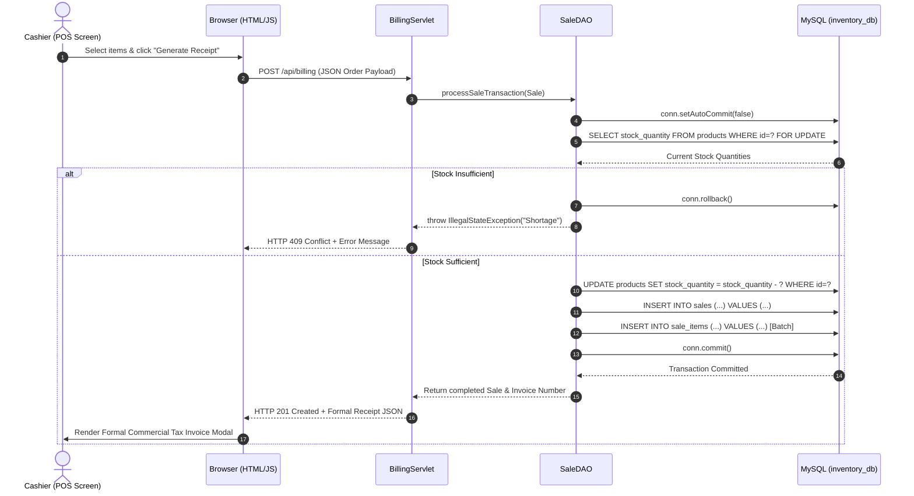
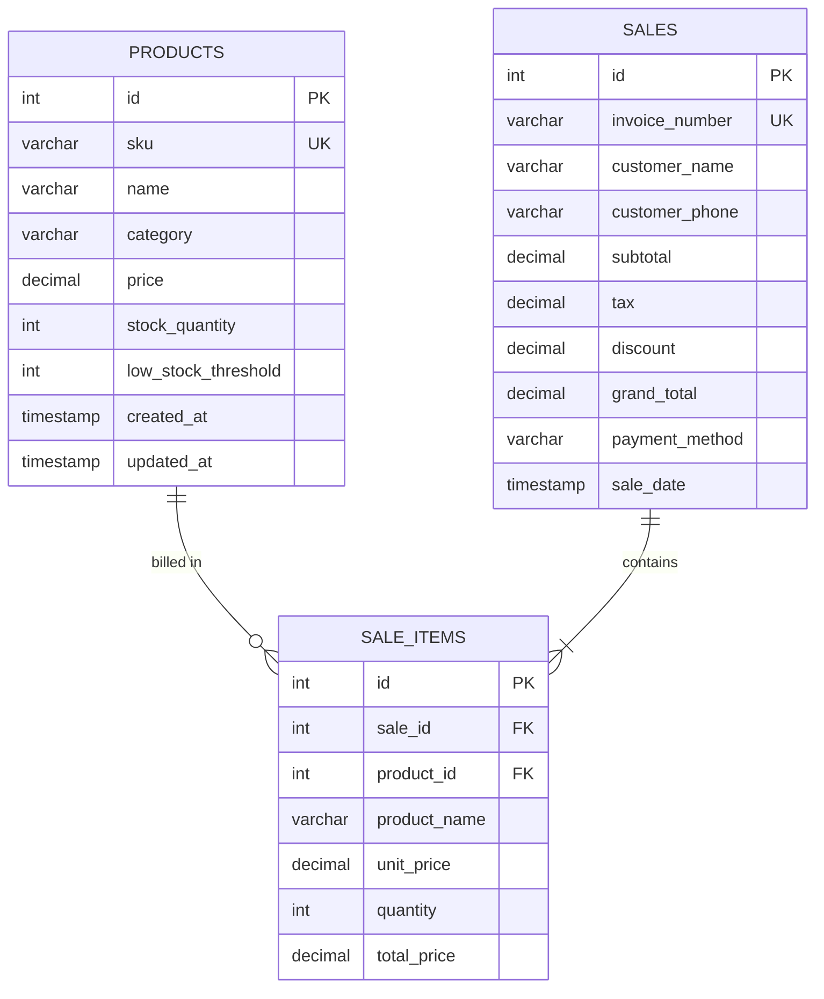

# ACADEMIC PROJECT REPORT

# INVENTORY & BILLING SYSTEM
### Stock Management with Instant Receipt Generation & Business Analytics

---

**Course / Subject:** Software Engineering & Advanced Web Technologies (Java Enterprise Stack)  
**Academic Year:** 2026–2027  

### Project Team & Module Distribution
| Student Name | Project Role | Core Module & Responsibilities |
| :--- | :--- | :--- |
| **Suraj Gusain** | **Backend Lead** | Java Servlets, JDBC API, Transaction Management & REST Endpoints |
| **Siddhesh Jagtap** | **Database Architect** | MySQL Database Design, Relational Schema, DDL/DML & Analytical Queries |
| **Saurabh Mishra** | **Frontend Lead** | HTML5, CSS3, Vanilla JavaScript, Classic POS UI, Formal Tax Invoice & Reports |

---

## TABLE OF CONTENTS
1. [Abstract](#1-abstract)
2. [Introduction & Problem Statement](#2-introduction--problem-statement)
3. [System Objectives & Scope](#3-system-objectives--scope)
4. [Technology Stack & Architectural Principles](#4-technology-stack--architectural-principles)
5. [System Architecture & Workflow](#5-system-architecture--workflow)
6. [Database Design & Data Dictionary (Siddhesh Jagtap)](#6-database-design--data-dictionary)
7. [Backend Design & Transaction Logic (Suraj Gusain)](#7-backend-design--transaction-logic)
8. [Frontend Design & Classic Interface (Saurabh Mishra)](#8-frontend-design--classic-interface)
9. [Reports & Business Analytics (Day, Week, Month)](#9-reports--business-analytics)
10. [Test Plan & Verification Results](#10-test-plan--verification-results)
11. [Conclusion & Future Enhancements](#11-conclusion--future-enhancements)

---

## 1. ABSTRACT

In contemporary retail and small-scale convenience retail enterprises, manual bookkeeping and handwritten paper bills remain prevalent yet severely defective practices. Such approaches suffer from high calculation error rates, stock discrepancies, accidental inventory stockouts, and absence of sales visibility.

The **Inventory & Billing System** is an integrated, full-stack enterprise web application developed specifically to eliminate these bottlenecks. Conforming strictly to a **"Zero External Frameworks"** engineering constraint, the solution utilizes the fundamental, robust web technologies: **Java Servlets**, **JDBC API**, **MySQL**, and **vanilla HTML5/CSS3/JavaScript**. 

The system unifies real-time inventory management with instant, single-request POS billing. Every completed invoice atomically decrements product inventory, logs itemized line items, generates a formal Commercial Tax Invoice with dynamic Amount in Words, and immediately updates comprehensive **End-of-Day, Weekly, and Monthly Analytics** for business tracking.

---

## 2. INTRODUCTION & PROBLEM STATEMENT

### 2.1 The Existing (Manual) System
Small retail establishments, stationeries, and neighborhood supermarkets traditionally track inventory via physical ledgers and compute bills using handheld calculators. This introduces severe operational flaws:
1. **Absence of Live Stock Count:** Stock balances are only discovered upon physical manual shelf checks, leading to unfulfilled orders and disappointed customers.
2. **Error-Prone Handwritten Invoicing:** Cashiers frequently calculate taxes, line totals, and subtotals incorrectly under rush-hour pressure.
3. **No Low-Stock Warning System:** Items deplete to zero without warning, leading to stockouts of high-turnover goods.
4. **Opaque Business Performance:** Shopkeepers lack visibility into end-of-day sales, weekly revenue patterns, or top-performing merchandise without hours of tedious manual tallying.

### 2.2 The Proposed Solution
The proposed system addresses each problem systematically:
- **Centralized Live Inventory:** Web-accessible catalog tracking unit prices, categories, and live quantity balances.
- **Instant POS Billing Screen:** Intuitive item selection with automated subtotal, 5% GST (split into CGST & SGST), discounts, and net payable grand total calculation.
- **Atomic Single-Request Flow:** The Servlet reads the order, opens an isolated JDBC database transaction, verifies stock, updates product inventory, persists the sale, and generates the invoice in one atomic step.
- **Formal Commercial Tax Invoice:** Complies with retail standards by featuring shop credentials, GSTIN, HSN/SKU, itemized rates, legal terms, authorized signature, and numbers converted into Indian currency words.
- **Executive Analytics:** Automated End-of-Day (Z-Report), 7-Day Weekly, and Monthly business performance reports.

---

## 3. SYSTEM OBJECTIVES & SCOPE

### 3.1 Core Objectives
1. **Data Integrity:** Prevent inventory race conditions using row-level locking (`SELECT ... FOR UPDATE`) and ACID-compliant transactions.
2. **High Responsiveness:** Sub-second checkout and receipt generation.
3. **Standards-Compliant Invoicing:** Formal, print-ready invoices adhering to commercial billing conventions.
4. **Actionable Analytics:** Provide shop owners with instant sales insights, category turnover, and stock replenishment recommendations.

### 3.2 System Scope
- **Inventory Management:** Add new SKUs, modify pricing/details, execute rapid bulk restocking, and delete discontinued items.
- **Warning Center:** Continuous monitoring flagging products where $\text{Quantity} \le \text{Threshold}$.
- **Point of Sale (POS):** Fast item lookup, dynamic live cart, quantity steppers, and single-click checkout.
- **Audit & Archival:** Full historical search by date range, invoice ID, or product name with reprint capability.
- **Management Reporting:** Real-time metrics across Daily, Weekly, and Monthly horizons.

---

## 4. TECHNOLOGY STACK & ARCHITECTURAL PRINCIPLES

In adherence to Slide 4 of the project presentation (*"No frameworks — just the core Java, JDBC, and web stack we already know"*), the application intentionally avoids heavyweight frameworks (such as Spring Boot, Hibernate, or Angular) to highlight fundamental systems programming and database connectivity.

```
+-------------------------------------------------------------------------+
|                              PRESENTATION LAYER                         |
|                    HTML5  ·  CSS3  ·  Vanilla JavaScript (ES6+)         |
|              Classic Accounting UI  ·  Fetch API  ·  Dual Mode Client   |
+-------------------------------------------------------------------------+
                                    │ HTTP / JSON
                                    ▼
+-------------------------------------------------------------------------+
|                              APPLICATION LAYER                          |
|             Java Servlets (Servlet API 4.0)  ·  Core Java POJOs         |
|                 BillingServlet  ·  ProductServlet  ·  AnalyticsServlet  |
|                   Built-in Standalone AppServer (Java SE HTTP)          |
+-------------------------------------------------------------------------+
                                    │ JDBC Driver (Type 4)
                                    ▼
+-------------------------------------------------------------------------+
|                                DATA ACCESS LAYER                        |
|            JDBC API (java.sql.*)  ·  PreparedStatements  ·  DAO Pattern |
|                         ProductDAO  ·  SaleDAO  ·  DBConnection        |
+-------------------------------------------------------------------------+
                                    │ TCP/IP Port 3306
                                    ▼
+-------------------------------------------------------------------------+
|                               DATABASE LAYER                            |
|                          MySQL Relational Database                      |
|                  InnoDB Engine  ·  Foreign Keys  ·  ACID Transactions   |
+-------------------------------------------------------------------------+
```

---

## 5. SYSTEM ARCHITECTURE & WORKFLOW

### 5.1 Slide 5 Core Billing Workflow
The core workflow coordinates the browser, servlet, JDBC, and database in a single atomic pipeline:



---

## 6. DATABASE DESIGN & DATA DICTIONARY
*Designed and Implemented by: **Siddhesh Jagtap***

The database is built on MySQL using the transactional `InnoDB` storage engine with strict relational constraints and indexing.

### 6.1 Entity-Relationship (ER) Schema


### 6.2 Data Dictionary

#### Table 1: `products` (Inventory Store)
| Column Name | Data Type | Constraints | Description |
| :--- | :--- | :--- | :--- |
| `id` | `INT` | Primary Key, Auto Increment | Unique internal product identifier |
| `sku` | `VARCHAR(50)` | NOT NULL, UNIQUE | Barcode or Stock Keeping Unit code |
| `name` | `VARCHAR(150)` | NOT NULL | Product name and description |
| `category` | `VARCHAR(100)` | NOT NULL, Default: 'General' | Merchandise category |
| `price` | `DECIMAL(10,2)` | NOT NULL, CHECK ($\ge 0$) | Unit selling price in Indian Rupees |
| `stock_quantity` | `INT` | NOT NULL, CHECK ($\ge 0$) | Current real-time units available |
| `low_stock_threshold`| `INT` | NOT NULL, Default: 5 | Minimum buffer before triggering alert |
| `created_at` | `TIMESTAMP` | Default: CURRENT_TIMESTAMP | Record registration timestamp |
| `updated_at` | `TIMESTAMP` | Auto-updates on edit | Last inventory change timestamp |

#### Table 2: `sales` (Invoice Master Record)
| Column Name | Data Type | Constraints | Description |
| :--- | :--- | :--- | :--- |
| `id` | `INT` | Primary Key, Auto Increment | Unique internal sale transaction ID |
| `invoice_number` | `VARCHAR(50)` | NOT NULL, UNIQUE | Formatted commercial invoice number |
| `customer_name` | `VARCHAR(100)` | NOT NULL, Default: 'Walk-in' | Buyer name |
| `customer_phone` | `VARCHAR(20)` | NULLABLE | Customer contact number |
| `subtotal` | `DECIMAL(10,2)` | NOT NULL | Taxable merchandise total |
| `tax` | `DECIMAL(10,2)` | NOT NULL, Default: 0.00 | Total 5% GST (CGST + SGST) |
| `discount` | `DECIMAL(10,2)` | NOT NULL, Default: 0.00 | Applied bill rebate |
| `grand_total` | `DECIMAL(10,2)` | NOT NULL | Net payable final amount |
| `payment_method` | `VARCHAR(50)` | NOT NULL, Default: 'Cash' | Tender type (Cash, UPI, Card) |
| `sale_date` | `TIMESTAMP` | Default: CURRENT_TIMESTAMP | Exact date and time of sale |

#### Table 3: `sale_items` (Itemized Bill Breakdown)
| Column Name | Data Type | Constraints | Description |
| :--- | :--- | :--- | :--- |
| `id` | `INT` | Primary Key, Auto Increment | Unique line item identifier |
| `sale_id` | `INT` | Foreign Key -> `sales(id)` | Parent transaction ID (Cascade delete) |
| `product_id` | `INT` | Foreign Key -> `products(id)`| Billed product reference (Restrict delete) |
| `product_name` | `VARCHAR(150)` | NOT NULL | Historical name snapshot at billing time |
| `unit_price` | `DECIMAL(10,2)` | NOT NULL | Unit price at moment of sale |
| `quantity` | `INT` | NOT NULL, CHECK ($> 0$) | Billed unit quantity |
| `total_price` | `DECIMAL(10,2)` | NOT NULL | Line item total ($\text{Qty} \times \text{Rate}$) |

### 6.3 Key Analytical SQL Queries
1. **Low Stock Warning Alert:**
   ```sql
   SELECT id, sku, name, category, stock_quantity, low_stock_threshold
   FROM products 
   WHERE stock_quantity <= low_stock_threshold 
   ORDER BY stock_quantity ASC;
   ```
2. **Product Movement & Revenue Ranking (Period Aggregation):**
   ```sql
   SELECT si.product_id, si.product_name, p.category, p.stock_quantity,
          SUM(si.quantity) AS units_sold,
          SUM(si.total_price) AS revenue_generated
   FROM sale_items si
   JOIN sales s ON si.sale_id = s.id
   LEFT JOIN products p ON si.product_id = p.id
   WHERE s.sale_date >= ? AND s.sale_date <= ?
   GROUP BY si.product_id, si.product_name, p.category, p.stock_quantity
   ORDER BY units_sold DESC;
   ```

---

## 7. BACKEND DESIGN & TRANSACTION LOGIC
*Designed and Implemented by: **Suraj Gusain***

### 7.1 Database Connection (`DBConnection.java`)
Manages standard JDBC connections using `DriverManager` with parameterized environment overrides (`DB_URL`, `DB_USER`, `DB_PASS`) and built-in connection liveness checks (`testConnection()`).

### 7.2 ACID Transaction Management in `SaleDAO.java`
To prevent race conditions and inventory corruption:
```java
Connection conn = DBConnection.getConnection();
try {
    conn.setAutoCommit(false); // Begin ACID Transaction

    // Step 1: Lock and verify stock
    for (SaleItem item : sale.getItems()) {
        PreparedStatement checkStmt = conn.prepareStatement(
            "SELECT name, price, stock_quantity FROM products WHERE id = ? FOR UPDATE");
        checkStmt.setInt(1, item.getProductId());
        ResultSet rs = checkStmt.executeQuery();
        if (rs.next()) {
            int stock = rs.getInt("stock_quantity");
            if (stock < item.getQuantity()) {
                throw new IllegalStateException("Insufficient stock for " + rs.getString("name"));
            }
            // Decrement Stock
            PreparedStatement decStmt = conn.prepareStatement(
                "UPDATE products SET stock_quantity = stock_quantity - ? WHERE id = ?");
            decStmt.setInt(1, item.getQuantity());
            decStmt.setInt(2, item.getProductId());
            decStmt.executeUpdate();
        }
    }

    // Step 2: Insert Sale Master Record
    // Step 3: Insert Line Items via Batch Processing
    
    conn.commit(); // Atomic Commit
} catch (Exception ex) {
    conn.rollback(); // Immediate Rollback on any failure
    throw ex;
}
```

### 7.3 Servlet Mapping
- `BillingServlet` (`/api/billing`): Handles atomic order processing.
- `ProductServlet` (`/api/products`): Handles catalog queries, restock actions, and edits.
- `SalesHistoryServlet` (`/api/sales`): Handles historical queries with multi-criteria filters.
- `DashboardServlet` (`/api/dashboard`): Delivers real-time counts for header counters.
- `AnalyticsServlet` (`/api/analytics`): Aggregates revenue, unit volume, and category metrics for Day, Week, and Month reports.
- `AppServer.java`: Built-in standalone HTTP server utilizing Java's `com.sun.net.httpserver.HttpServer` enabling direct execution without external Tomcat installation.

---

## 8. FRONTEND DESIGN & CLASSIC INTERFACE
*Designed and Implemented by: **Saurabh Mishra***

### 8.1 UI Design Philosophy
The user interface follows a **Classic Business & Accounting** aesthetic:
- **Palette:** Deep Corporate Navy (`#1e3a8a`, `#0f172a`), Crisp Slate Surfaces (`#f8fafc`, `#ffffff`), Status Amber (`#d97706`), and Emerald (`#16a34a`).
- **Typography:** High-legibility Inter coupled with JetBrains Mono for monetary values and SKU identifiers.
- **Classic Contrast:** High-contrast bordered accounting tables with generous padding and word spaces.

### 8.2 POS Billing Screen
- **Catalog Selector:** Categorized cards displaying price, SKU, and live stock indicator (Green = Healthy, Yellow = Low Stock, Red = Out of Stock).
- **Interactive Cart:** Quantity controls with automatic bounds-checking ($\text{Requested} \le \text{Available Stock}$).
- **Financial Calculation Engine:** Automated computation of Subtotal, 5% GST, Rebates, and Net Payable.

### 8.3 Formal Commercial Tax Invoice (Cash Memo)
Unlike raw monospace thermal printouts, the generated invoice complies with commercial retail norms:
1. **Registered Shop Masthead:** Name, GSTIN (`27AABCS1429B1Z`), State Code (`27 - Maharashtra`), Address, and Contact details.
2. **Metadata Grid:** Generously spaced 2-column box displaying Invoice No, Date, Time of Issue, Place of Supply, Customer Info, and POS Terminal.
3. **Itemized Accounting Table:** Clear columns for `#`, `Description`, `SKU`, `Qty`, `Unit Rate`, and `Total`.
4. **Tax Split:** Distinct line items for **CGST @ 2.50%** and **SGST @ 2.50%**.
5. **Amount in Words (`numberToWordsINR`):** Converts numbers to words following Indian currency nomenclature:
   $$\text{₹541.75} \longrightarrow \text{"Indian Rupees Five Hundred Forty-One and Seventy-Five Paise Only"}$$
6. **Legal Terms & Signatory Area:** Return policy, jurisdiction notice, and signature line for the authorized cashier.

---

## 9. REPORTS & BUSINESS ANALYTICS
The dedicated **Reports & Analytics** module introduces managerial reporting directly inside the application:

### 9.1 Time Horizon Reports
- **End of Day Report (Z-Report):** Generates a complete daily register closing showing total gross sales, bill counts, average basket size, and units sold today.
- **End of Week Report (7-Day Overview):** Aggregates weekly revenue trends and identifies days of peak customer traffic.
- **End of Month Report (Monthly Turnover):** Monthly gross turnover and inventory movement rates.
- **Custom Range Report:** Flexible date-bounded reporting for tax auditing.

### 9.2 Key Performance Indicators (KPIs)
$$\text{Average Bill Value} = \frac{\text{Total Gross Revenue}}{\text{Total Completed Invoices}}$$

### 9.3 Product & Category Breakdown
- **Product Ranking Table:** Ranks items by unit sales volume, displaying revenue generated alongside current shelf balances to instantly flag fast-moving goods nearing depletion.
- **Category Split:** Summarizes which departments (Stationery, Groceries, Dairy, Electronics) drive the store's revenue.
- **One-Click Store Report Printing:** Generates a clean management summary formatted for official record-keeping.

---

## 10. TEST PLAN & VERIFICATION RESULTS

| Test ID | Module | Test Scenario | Input Data | Expected Result | Actual Result | Status |
| :---: | :--- | :--- | :--- | :--- | :--- | :---: |
| **TC-01** | Database | Create tables & foreign key cascade | Execute `schema.sql` | All 3 tables created with constraints | Tables created cleanly | **PASS** |
| **TC-02** | Inventory | Add new SKU to database | Name: "Gel Pen", Qty: 20, Price: ₹15 | Product saved; displayed in table | Product created with SKU | **PASS** |
| **TC-03** | Warnings | Stock drops below threshold | Threshold: 5, Current Stock: 3 | Flagged in Low-Stock Alert tab | Displayed with amber badge | **PASS** |
| **TC-04** | POS Cart | Add item exceeding current stock | Requested: 15, Available: 10 | Error prevented; capped at 10 | Inline alert displayed | **PASS** |
| **TC-05** | Billing | Atomic checkout & stock deduction | Sale of 2 Spiral Notebooks (Stock: 35) | Stock decreases to 33; invoice logged | Stock deducted to 33; bill created | **PASS** |
| **TC-06** | Invoicing | Currency to Words conversion | Amount: ₹467.25 | "Indian Rupees Four Hundred Sixty-Seven and Twenty-Five Paise Only" | Correct string rendered | **PASS** |
| **TC-07** | Analytics | End-of-Day report aggregation | Filter: Today | Calculates today's orders & revenue | KPI tiles match sales sum | **PASS** |
| **TC-08** | Print | Invoice and Report Print formatting | Click "Print Tax Invoice" | Hides buttons; renders clean invoice | Clean layout rendered | **PASS** |

---

## 11. CONCLUSION & FUTURE ENHANCEMENTS

### 11.1 Conclusion
The **Inventory & Billing System** fulfills all requirements set forth in the project presentation. By intentionally avoiding third-party frameworks, the team demonstrated the power of core Java Servlets, direct JDBC database connectivity, and structured SQL transactions. The resulting software provides small businesses with an intuitive, reliable, and demo-ready point-of-sale tool that eliminates billing mistakes, prevents stock depletion, and delivers actionable business analytics.

### 11.2 Future Enhancements
1. **Hardware Barcode Scanner Support:** USB and Bluetooth HID barcode scanner integration for automatic item addition.
2. **Digital Invoice Dispatch:** Direct dispatch of generated PDF invoices to customers via WhatsApp Business API or SMS.
3. **Multi-Store Cloud Synchronization:** Support for central warehouse management distributing inventory across multiple branch stores.
