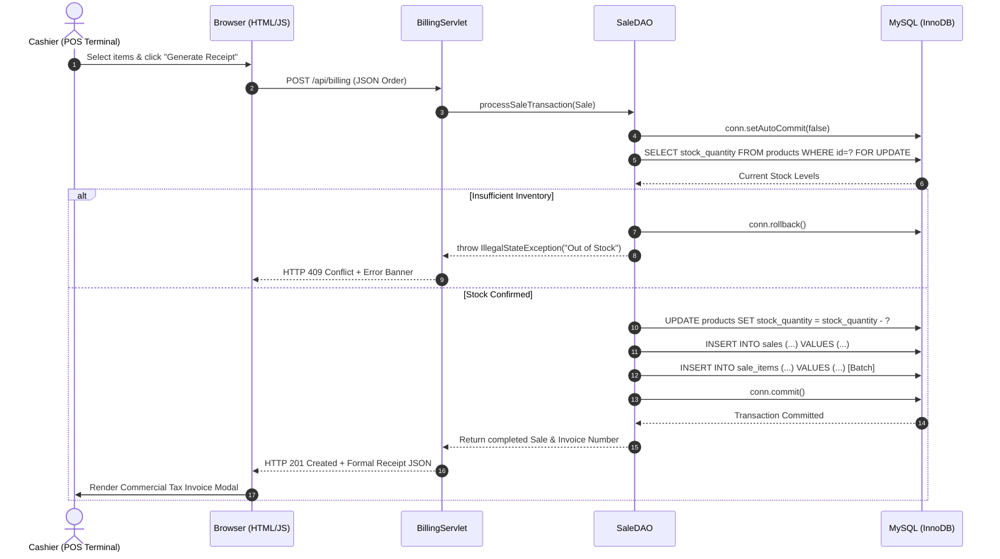
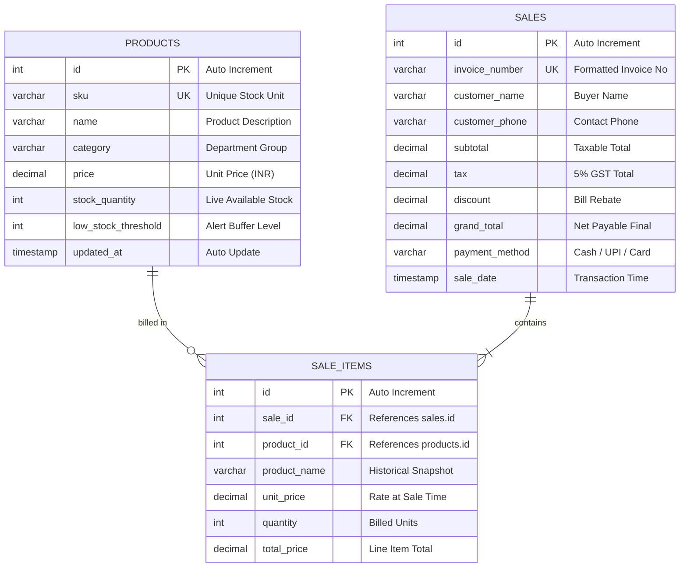

<div align="center">

# 📦 Inventory & Billing System
### *Real-Time Stock Management · Atomic POS Billing · Commercial Tax Invoicing*

[](https://www.oracle.com/java/)
[](https://www.mysql.com/)
[](https://developer.mozilla.org/en-US/docs/Web/JavaScript)
[](https://developer.mozilla.org/en-US/docs/Web/HTML)
[](https://developer.mozilla.org/en-US/docs/Web/CSS)
[](https://vercel.com)
[](LICENSE)

<br/>

> **"Zero Frameworks — Just the pure power of Java Servlets, JDBC, MySQL, and Modern Web Standards."**

[Explore Features](#-key-features) • [Quick Start](#-quick-start) • [Architecture](#-system-architecture) • [Database Design](#-database-design--er-diagram) • [Team](#-team--module-distribution)

</div>

---

## 🌟 Executive Summary

In retail enterprises, manual bookkeeping and handwritten receipts cause stockouts, calculation mistakes, and opaque sales performance. The **Inventory & Billing System** is an enterprise-grade full-stack solution built to eliminate these friction points.

Conforming strictly to a **zero-third-party-frameworks** engineering standard, this system pairs high-speed **Point of Sale (POS) checkout** with **atomic inventory deductions**, **GST-compliant commercial tax invoicing**, and **automated End-of-Day executive analytics**.

---

## ✨ Key Features

```
┌─────────────────────────────────────────────────────────────────────────────┐
│                            CORE CAPABILITIES                                │
├──────────────────────────┬──────────────────────────┬───────────────────────┤
│ 🛒 Instant POS Billing   │ 🔒 Atomic Stock Locking  │ 🧾 Formal Tax Invoice │
│ Fast item lookup, live   │ Single JDBC transaction  │ GSTIN, HSN/SKU, CGST/ │
│ cart computation, and    │ with FOR UPDATE locking  │ SGST, and Amount-in-  │
│ instant checkout.        │ prevents race conditions │ Words conversion.     │
├──────────────────────────┼──────────────────────────┼───────────────────────┤
│ ⚠️ Low-Stock Alerts      │ 📊 Executive Analytics   │ 🌐 Intelligent Dual   │
│ Early warning center for │ End-of-Day (Z-Report),   │ Works live with Java  │
│ stock at or below buffer │ 7-day weekly trends, and │ or offline in browser │
│ threshold.               │ category revenue shares. │ via LocalStorage.     │
└──────────────────────────┴──────────────────────────┴───────────────────────┘
```

* ⚡ **Sub-Second Atomic Checkout**: A single HTTP POST coordinates catalog validation, inventory reduction, master sales persistence, and line item batch insertion in an ACID-isolated transaction.
* 🧾 **Commercial Tax Invoice (Cash Memo)**: Produces print-ready legal tax invoices featuring shop masthead, GSTIN, invoice metadata, dual tax split (CGST @ 2.5% & SGST @ 2.5%), and automatic **Indian Currency-in-Words** rendering:
  $$\text{₹541.75} \longrightarrow \text{"Indian Rupees Five Hundred Forty-One and Seventy-Five Paise Only"}$$
* 📊 **Management Reports & Analytics**:
  * **End-of-Day (Z-Report)**: Today's orders, gross revenue, units sold, and average basket size.
  * **Weekly & Monthly Horizons**: Trend lines for revenue turnover and peak sales days.
  * **Fast-Mover Product Ranking**: Prioritizes items nearing depletion.
* 🌐 **Intelligent Dual-Mode Client**: Connects transparently to Java Servlet endpoints (`/api/*`), or falls back to an in-browser local storage engine for instant offline demos and Vercel deployments.

---

## 🏗️ System Architecture

The project adheres to a clean, decoupled **3-Tier Architecture**:

```
+-------------------------------------------------------------------------+
|                           PRESENTATION TIER                             |
|              HTML5  ·  CSS3  ·  Vanilla JavaScript (ES6+)               |
|            Classic Accounting UI  ·  Fetch API  ·  Dual-Mode            |
+-------------------------------------------------------------------------+
                                    │ HTTP / JSON Payloads
                                    ▼
+-------------------------------------------------------------------------+
|                           APPLICATION TIER                              |
|           Java Servlets 4.0  ·  POJOs  ·  Standalone AppServer          |
|      BillingServlet  ·  ProductServlet  ·  AnalyticsServlet             |
+-------------------------------------------------------------------------+
                                    │ JDBC Driver (Type 4)
                                    ▼
+-------------------------------------------------------------------------+
|                           DATA ACCESS LAYER                             |
|          JDBC API (java.sql.*)  ·  PreparedStatements  ·  DAO           |
|                ProductDAO  ·  SaleDAO  ·  DBConnection                 |
+-------------------------------------------------------------------------+
                                    │ TCP/IP Port 3306
                                    ▼
+-------------------------------------------------------------------------+
|                            DATABASE LAYER                               |
|                       MySQL Relational Database                         |
|             InnoDB Engine  ·  Foreign Keys  ·  ACID Transactions        |
+-------------------------------------------------------------------------+
```

---

## ⚡ Slide 5: Core Atomic Transaction Workflow



---

## 🗄️ Database Design & ER Diagram

The database utilizes the relational **InnoDB** engine with strict foreign key constraints and automated index optimization.



---

## 📂 Project Directory Structure

```text
inventory-billing-system/
├── database/
│   ├── schema.sql                       # Siddhesh Jagtap: MySQL DDL, indexes & constraints
│   └── seed_data.sql                    # Initial product catalog & baseline test sales
├── src/
│   └── main/
│       ├── java/
│       │   └── com/inventory/
│       │       ├── config/
│       │       │   └── DBConnection.java       # Central JDBC connection manager
│       │       ├── dao/
│       │       │   ├── ProductDAO.java         # Inventory CRUD, restock & low-stock queries
│       │       │   └── SaleDAO.java            # Atomic ACID billing transactions & search
│       │       ├── model/
│       │       │   ├── Product.java            # Product POJO entity
│       │       │   ├── Sale.java               # Sale header POJO entity
│       │       │   └── SaleItem.java           # Itemized bill line item entity
│       │       ├── server/
│       │       │   └── AppServer.java          # Standalone embedded Java HTTP server
│       │       └── servlet/
│       │           ├── AnalyticsServlet.java   # /api/analytics (Day, Week, Month reports)
│       │           ├── BillingServlet.java     # /api/billing (Instant receipt generator)
│       │           ├── DashboardServlet.java   # /api/dashboard (Real-time summary KPIs)
│       │           ├── ProductServlet.java     # /api/products (Catalog management)
│       │           └── SalesHistoryServlet.java # /api/sales (Searchable sales archive)
│       └── webapp/
│           ├── WEB-INF/
│           │   └── web.xml                     # Servlet 4.0 standard deployment descriptor
│           ├── css/
│           │   └── styles.css                  # Corporate Navy UI, print styles & badges
│           ├── js/
│           │   ├── api.js                      # Dual-mode API client (Servlet / LocalStorage)
│           │   └── app.js                      # POS controller, cart engine & receipt modal
│           └── index.html                      # Unified single-page POS application
├── pom.xml                                     # Maven build file with embedded Tomcat
├── vercel.json                                 # Static deployment configuration for Vercel
├── PROJECT_REPORT.md                           # Detailed academic report & documentation
└── README.md                                   # Project documentation & presentation guide
```

---

## 🚀 Quick Start Guide

### Option 1: Instant Browser Demo (Zero Setup)
The frontend features an intelligent **Dual Mode**. If accessed directly without a Java backend running, it automatically switches to interactive client demo mode:
1. Navigate to [`src/main/webapp/index.html`](src/main/webapp/index.html).
2. Double-click to open in any modern browser (Chrome, Edge, Firefox, Safari).
3. Test all features: add to cart, trigger instant checkout, print formal tax invoices, update stock, and inspect analytics.

---

### Option 2: Full-Stack Java + MySQL

#### 1. Initialize MySQL Database
```bash
# Log in to MySQL and run setup scripts
mysql -u root -p < database/schema.sql
mysql -u root -p < database/seed_data.sql
```
*Tip: Configure custom credentials using environment variables `DB_USER` and `DB_PASS`, or modify `DBConnection.java`.*

#### 2. Run with Standalone Java AppServer (No Tomcat Required)
```bash
mvn compile exec:java -Dexec.mainClass="com.inventory.server.AppServer"
```
Then visit **`http://localhost:8080/`** in your browser.

#### 3. Run with Maven Tomcat Plugin
```bash
mvn tomcat7:run
```
Access the application at **`http://localhost:8080/inventory-billing/`**.

---

### Option 3: Deploy to Vercel in 60 Seconds

This repository includes a pre-configured [`vercel.json`](vercel.json):
1. Push this repository to your GitHub account:
   ```bash
   git push -u origin main
   ```
2. Navigate to [vercel.com/new](https://vercel.com/new) and click **Import** next to `inventory-billing-system`.
3. Click **Deploy**. Vercel will immediately host the interactive web application live!

---

## 👥 Team & Module Distribution

| Team Member | Project Role | Core Module & Responsibilities |
| :--- | :--- | :--- |
| **Suraj Gusain** | **Backend Lead** | Java Servlets 4.0, JDBC connection pooling, atomic transaction management (`SaleDAO`), and REST/JSON endpoints (`BillingServlet`, `ProductServlet`, `AnalyticsServlet`). |
| **Siddhesh Jagtap** | **Database Architect** | MySQL schema DDL (`schema.sql`), relational constraints, indexing, seed data (`seed_data.sql`), and analytical aggregation queries. |
| **Saurabh Mishra** | **Frontend Lead** | Vanilla HTML5/CSS3/JavaScript single-page POS UI, live cart computations, printable commercial tax invoice with currency-to-words engine, and responsive theme. |

---

## 🧪 Test Execution Matrix

| Test ID | Module | Scenario | Expected Result | Status |
| :---: | :--- | :--- | :--- | :---: |
| **TC-01** | Database | Table creation & cascading foreign keys | All tables created with relational constraints | `PASS` |
| **TC-02** | Inventory | Register new SKU into database | Product saved and indexed in catalog | `PASS` |
| **TC-03** | Alerting | Stock drops at or below buffer threshold | Flagged instantly in Warning Center tab | `PASS` |
| **TC-04** | POS Cart | Request item exceeding shelf stock | Prevents cart overfill with inline constraint warning | `PASS` |
| **TC-05** | Billing | Atomic checkout & inventory deduction | Stock decremented, invoice persisted atomically | `PASS` |
| **TC-06** | Invoicing | Numeric grand total to INR words | Number correctly formatted to formal Indian words | `PASS` |
| **TC-07** | Analytics | End-of-Day Z-Report revenue aggregation | Real-time calculation matches sum of daily sales | `PASS` |
| **TC-08** | Invoicing | Print formatting for thermal / A4 receipts | Clean printable layout without navigation headers | `PASS` |

---

## 📄 License & Attribution

Developed for academic presentation and real-world deployment demonstration.  
© 2026 **Suraj Gusain, Siddhesh Jagtap, and Saurabh Mishra**. Released under the [MIT License](LICENSE).
